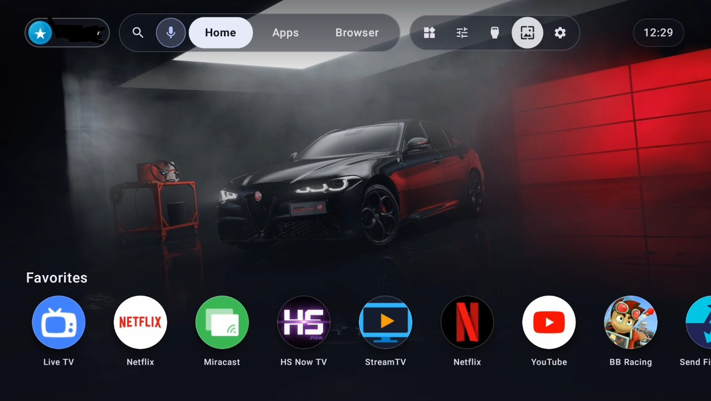

*```RNA. TV``` — Ultimate Android TV & Google TV Launcher, Web Container & AI Ecosystem*



```RNA. TV``` is a next-generation, high-performance, ad-free Android TV / Google TV launcher and application runtime built with Kotlin and Jetpack Compose. It bridges native Android capabilities with web applications (.rna bundles), offering a sleek Material Design 3 Expressive interface, multi-user profiles, 4K wallpapers, autonomous AI agent abilities, advanced remote remapping, and cross-device phone control.


```🌟*Key Features*```

Ad-Free Google TV Launcher: Clean, lightning-fast home screen with customizable single-row or two-row app docks, recent apps history, and instant app launching.

Liquid Glass Orb Hover Animation: Premium refractive glass orb that glides smoothly between app icons with spring physics and iridescent Fresnel rim lighting.

43+ Bundled 4K Wallpapers + Custom Wallpapers: Switch instantly between stunning 4K preset wallpapers or pick your own custom photos with zero latency.

Multi-User Offline Profiles: Create separate profiles with custom avatars (28 offline preset avatars + local photo picker) and isolated or shared browser data.

Integrated TV Web Browser: Full-featured web browser with on-screen D-Pad keyboard, full-screen mode, and one-tap conversion of websites into standalone TV apps.

RNA. AI Assistant & Agentic Control: Full-screen AI assistant with conversation history stored locally and autonomous capabilities (screenshots, D-Pad actions, app/website launching).

RNA. Controller & Gamepad Bridge: Control your TV from your phone over local Wi-Fi with an M3 Expressive gamepad and remote featuring remapped physical Xbox/Android buttons.

Performance Mode: Instant toggle in the Control Panel that disables all animations for maximum speed on resource-constrained TV boxes.


```📥*Installation & Setup Instructions*```

To install and configure RNA. TV on your Android TV or Google TV device, follow these step-by-step instructions:

Step 1: Install "Send Files to TV" (SFTV) on TV and Phone
On your Android TV / Google TV, open the Google Play Store, search for "Send Files to TV" (SFTV), and install it.
[Note: after this step it is recommended to disabled Google Play Store while installation from Settings>Apps>View all Apps>Google Pay Store as otherwise it is very likely that Google would block the install of the RNA. TV apk. Once the RNA. TV app has been installed, you can enable Google Play Store back again.]
On your Android Phone / Tablet, open the Google Play Store, search for "Send Files to TV" (SFTV), and install the companion app.

Step 2: Transfer the .rna / APK File to Your TV
Export or download the RNA. TV installation APK (rna.apk) or .rna bundle file on your phone from this repo's releases.
Open Send Files to TV on both your TV (select Receive) and your phone (select Send).
Select the rna.apk file on your phone and choose your TV to transfer the file wirelessly over your local Wi-Fi network.

Step 3: Install the App on Your TV
On your TV, open your file manager (or the File Explorer inside SFTV / Downloads).
Click on the transferred rna.apk file.
When prompted by Android Security, allow installation from unknown sources for your file manager, then click Install.

Step 4: Grant Accessibility Permission (Crucial for TV Home Button Interception)
To ensure that pressing the Home or Back button on your TV remote always keeps you inside RNA. TV (replacing the default stock launcher seamlessly):
On your Android TV, open Android Settings.
Navigate to Device Preferences (or Settings > Accessibility).
Select Accessibility.
Find RNA. (or RNA. Home Interceptor Service) in the list of services and toggle it ON.
Grant any other requested permissions (such as Display over other apps and Usage Access) when prompted during first launch to enable Live AI assistant overlays and fast app switching.


```🛠️*Control Panel & Performance Customization*```

Press the Controls button in the top bar of RNA. TV to open the Control Panel:

Toggle Glass Orb Hover Animation ON/OFF.

Toggle Startup Wallpaper Splash Screen ON/OFF.

Toggle Performance Mode to instantly remove animations for maximum responsiveness.

Set sleep timers, adjust night blue-light warmth filters, and configure voice assistant settings.

```📄*License & Open Source*```

RNA. TV is built for high performance and privacy. All profiles, browser sessions, and preferences are stored 100% locally on your device.

Open-Source code is shared along the install .apk file.
