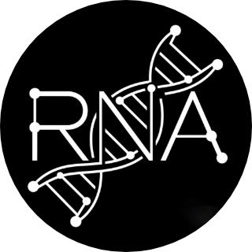

<div align="center">



# RNA TV

*[```RNA. TV```](https://github.com/frosty-sys/rnatv/releases) is the ultimate Android TV & Google TV Launcher, Web Container & AI Ecosystem*

[](LICENSE)
[](https://github.com/frosty-sys/rnatv/releases/latest)
[](https://github.com/pgxor/com.vadhod.apkextractor/actions/workflows/build.yml)
[-3DDC84?style=flat-square&logo=android&logoColor=white)](#requirements)
[](https://kotlinlang.org)
[](https://developer.android.com/compose)
</div>


```RNA. TV``` is a next-generation, high-performance, ad-free Android TV / Google TV launcher and application runtime built with Kotlin and Jetpack Compose. It bridges native Android capabilities with web applications (.rna bundles), offering a sleek Material Design 3 Expressive interface, multi-user profiles, 4K wallpapers, autonomous AI agent abilities, advanced remote remapping, and cross-device phone control.


```🌟*Key Features*```

Ad-Free Google TV Launcher: Clean, lightning-fast home screen with customizable single-row or two-row app docks, recent apps history, and instant app launching.

Liquid Glass Orb Hover Animation: Premium refractive glass orb that glides smoothly between app icons with spring physics and iridescent Fresnel rim lighting.

43+ Bundled 4K Wallpapers + Custom Wallpapers: Switch instantly between stunning 4K preset wallpapers or pick your own custom photos with zero latency.

Multi-User Offline Profiles: Create separate profiles with custom avatars (28 offline preset avatars + local photo picker) and isolated or shared browser data.

Integrated TV Web Browser: Full-featured web browser with on-screen D-Pad keyboard, full-screen mode, and one-tap conversion of websites into standalone TV apps.

RNA. AI Assistant & Agentic Control: Full-screen AI assistant with conversation history stored locally and autonomous capabilities (screenshots, D-Pad actions, app/website launching).
